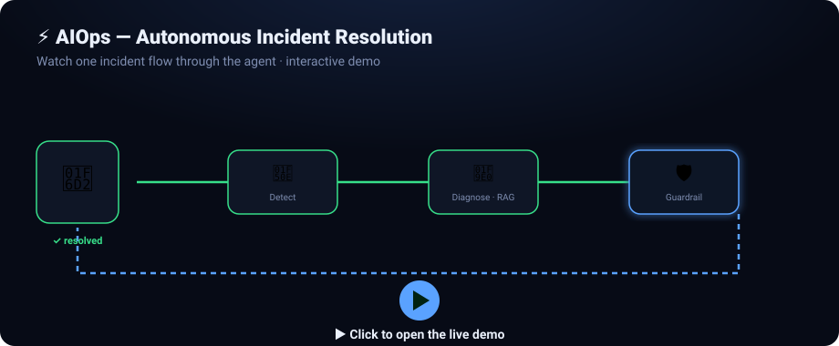

# AIOps Platform — Autonomous Incident Resolution

An AI agent that takes an incident (logs, metrics, traces), finds the likely root cause using your runbooks, picks a remediation, and runs it only if deterministic safety rules allow it.

[](https://razzdrawon.github.io/aiops-platform/demo/aiops-visual.html)

**[Watch an incident flow through the agent →](https://razzdrawon.github.io/aiops-platform/demo/aiops-visual.html)** (two scenarios: auto-resolved, and blocked → escalated)

## How it works

```
incident → detect → diagnose (RAG + LLM) → choose action → guardrail → execute → report
                                                              │
                                              blocked ────────┴──→ report (skips execute)
```

- **Diagnose:** searches a Pinecone index of runbooks, then an LLM proposes a root cause.
- **Guardrail:** plain Python, outside the LLM. Destructive actions (rollback, restart) need `confidence > 0.85`, otherwise they are blocked.
- **Persist:** every incident, with its per-node trace (latency, tokens, cost), is stored in PostgreSQL.
- **Offline mode:** with no API keys, the pipeline falls back to heuristics, so it runs with no external services.

**Design choice:** the LLM only proposes. Safety is enforced by deterministic code it cannot override, and the system keeps working when the LLM is unavailable.

> Remediation tools (rollback, restart, scale, open PR) are simulated. They log the action and return a mock result.

## Run it

```bash
git clone git@github.com:razzdrawon/aiops-platform.git && cd aiops-platform
docker compose up --build
```

Then trigger an incident:

```bash
curl -s -X POST http://localhost:8000/incident \
  -H "Content-Type: application/json" \
  -d '{"title": "High error rate on checkout", "signals": {"error_rate": 0.12}}'
```

API docs: http://localhost:8000/docs

For LLM mode, put `OPENAI_API_KEY` and `PINECONE_API_KEY` in `.env`, then run `python -m app.knowledge.indexer` once to index the runbooks.

<details>
<summary>Run without Docker, tests and evals</summary>

```bash
python3.11 -m venv .venv && source .venv/bin/activate
pip install -e ".[dev]"
docker compose up -d db && alembic upgrade head
uvicorn app.api.main:app --reload

pytest tests/unit/ -v        # no DB or API keys needed
pytest tests/integration/    # needs PostgreSQL
python -m evals.runner       # 22 golden cases
```
</details>

## API

| Method | Endpoint | Description |
|---|---|---|
| `POST` | `/incident` | Run the pipeline and persist the result |
| `GET` | `/incidents`, `/incidents/{id}` | List incidents, or get one with its full output |
| `GET` | `/incidents/{id}/trace` | Per-node latency, tokens and cost |
| `GET` | `/metrics/summary` | Block rate and averages |
| `GET` | `/health` | Health check |

## Stack

Python 3.11 · FastAPI · PostgreSQL (async SQLAlchemy) · LangGraph · OpenAI · Pinecone · Kafka · Docker · Terraform (AWS)

## More

[Architecture](docs/architecture.md) · [Technical decisions](docs/technical-decisions.md) · [Validation guide](docs/validation-guide.md) · [Roadmap](docs/roadmap.md) · [Terraform](terraform/)

Status: phases 1–3 done (foundation, evals, observability). Phases 4–6 (integrations, production hardening, cloud deploy) are in the [roadmap](docs/roadmap.md).
